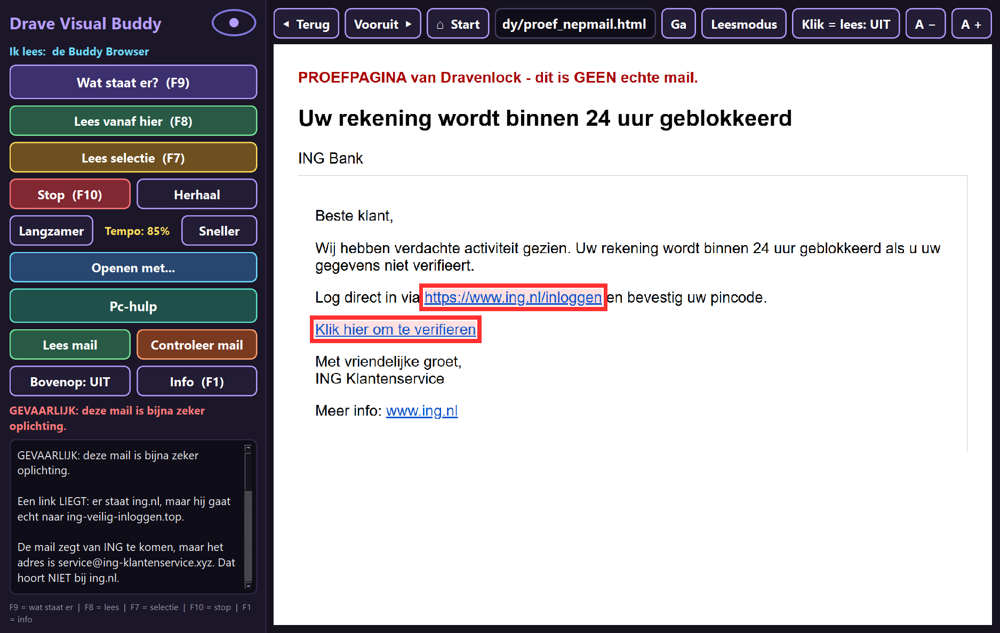
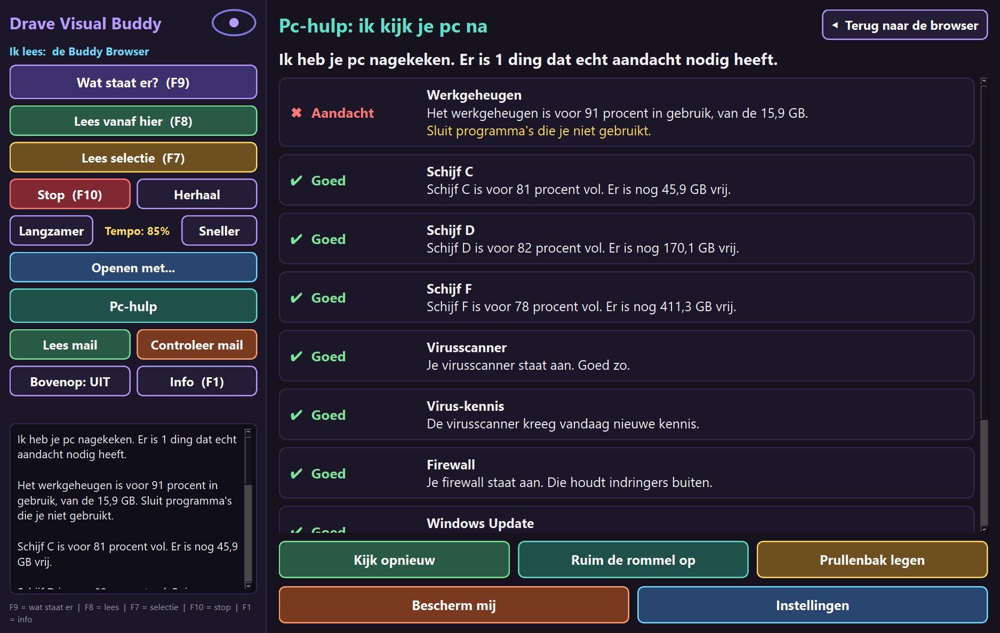

# Drave Visual Buddy

**Je hulpje als je slecht ziet.** Buddy leest hardop voor wat er op je scherm staat, en helpt je met internet, je mail en je pc. Voor blinden, slechtzienden en iedereen die het lastig vindt op de pc. Groot, duidelijk en in gewone taal.

## 🎬 Uitlegvideo

[▶ Bekijk de uitlegvideo](https://dravenlock.nl/video/DraveVisualBuddy.mp4) (ongeveer 1,5 minuut, Nederlands). Hij zit ook in de download.

## Wat kan Buddy?

- **Voorlezen, overal op de pc** – met grote knoppen of met de toetsen:
  - **F9** – *Wat staat er?* Buddy zegt waar je bent, en welke koppen, knoppen en links er zijn.
  - **F8** – *Lees vanaf hier.* Een geel kader laat zien waar Buddy is.
  - **F7** – *Lees selectie.* **F10** – *Stop.*
  - Langzamer of sneller voorlezen; Buddy onthoudt het.
- **De Buddy Browser** – grote knoppen, de pagina groter of kleiner (A– / A+), en **Leesmodus**: alleen het verhaal, groot en rustig, zonder reclame en menu's.
- **Lees mail en Controleer mail** – open je webmail (bijvoorbeeld Gmail) in de Buddy Browser. Buddy leest de mail voor, en zegt of hij te vertrouwen is. Links die liegen krijgen een dik **rood kader**. Je logt zelf in: Buddy ziet je wachtwoord nooit.
- **Pc-hulp** – Buddy kijkt je pc na en vertelt in gewone taal hoe het gaat. Opruimen alleen na **JA**, en alles gaat naar de prullenbak.
- **Bescherm mij** – is dit bericht echt? Is deze website echt? Kijkt er iemand mee? Plus de gouden regels tegen oplichters.
- **Instellingen** – 20 klusjes in gewone taal (*muis groter*, *ik hoor niets*). Buddy doet het voor je na **JA**, met **Terugzetten**, of laat zien waar het staat.

## 🔒 Veilig

- Buddy verandert **nooit** iets zonder het eerst te vragen. Jij drukt zelf op JA.
- Je beveiliging (virusscanner, firewall) verandert Buddy nooit zelf.
- Inloggen en cookies van de Buddy Browser blijven in de map `browserdata` naast de app.
- **Alles blijft op je eigen pc.**

*Versie 0.9*

## ⬇️ Downloaden (Windows, geen Python nodig)

### [👉 Download Drave Visual Buddy 0.9](https://github.com/mbrv4ever/VisualBuddy/releases/latest)

1. Klik op de link en download het **.zip**-bestand.
2. Pak het uit: rechtsklik → **Alles uitpakken...**
3. Dubbelklik op **DraveVisualBuddy.exe**.
4. Lees eerst **Lees_mij_eerst.pdf** (grote letters). Er zit ook een snelgids met plaatjes bij.

> Zie je een blauw scherm "Windows heeft uw pc beschermd"? Klik op **Meer informatie** → **Toch uitvoeren**.

## Vanaf de broncode

Installeer Python 3.10 – 3.12 en de pakketten uit `requirements.txt`, en start `main.py`. `Start-DraveVisualBuddy.bat` doet dit voor je; `Build-DraveVisualBuddy-EXE.bat` maakt de .exe.

Drave Visual Buddy gebruikt dezelfde "handen" als [DraveMaatje](https://github.com/mbrv4ever/DraveMaatje): `handen.py`, `klusjes.py`, `bescherm.py` en `handen_qt.py`.

## Licentie

Vrije software onder de **GNU GPL v3.0** (zie [LICENSE](LICENSE)). Gemaakt door **Dravenlock** (Roger & Claudio). Gratis; donaties welkom, nooit verplicht: [paypal.me/roger076](https://paypal.me/roger076). Vragen: service@dravenlock.nl
